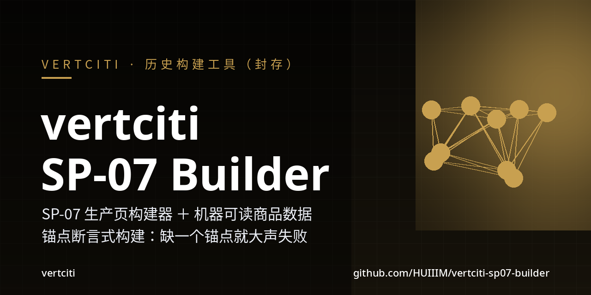
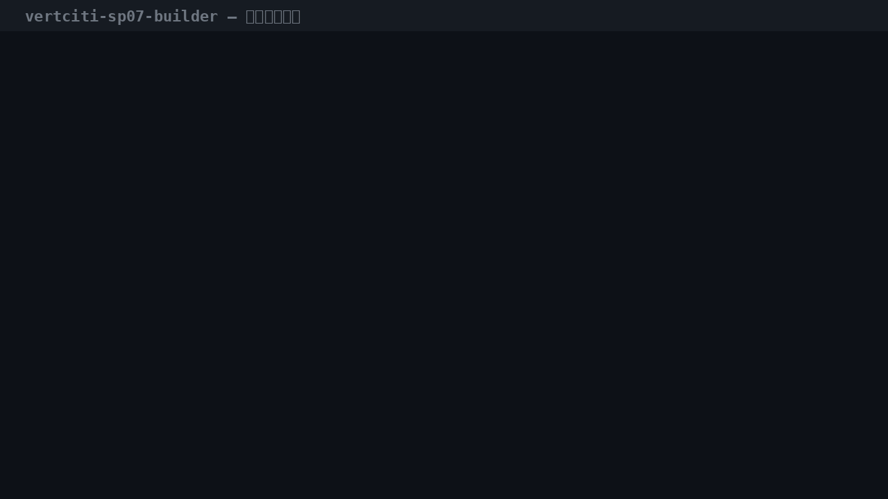
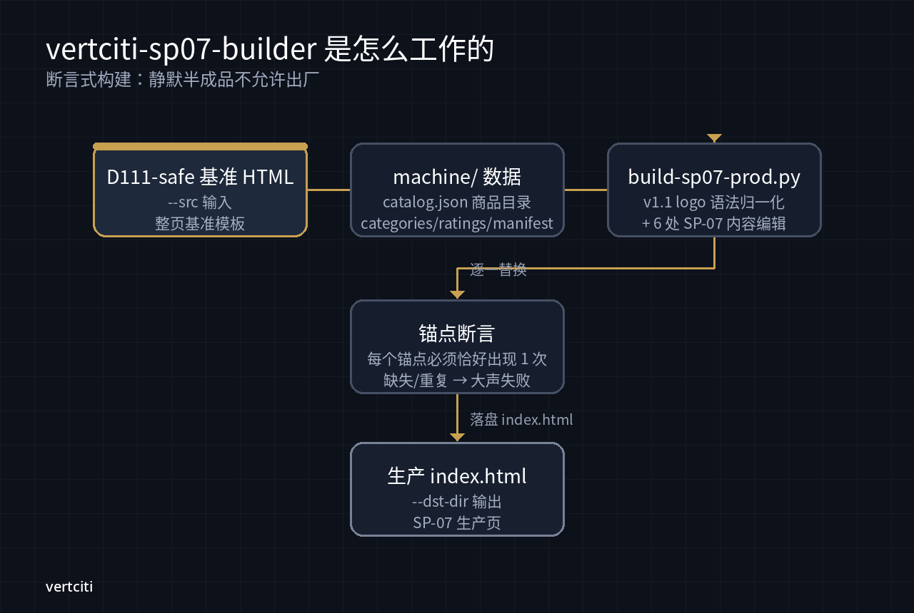
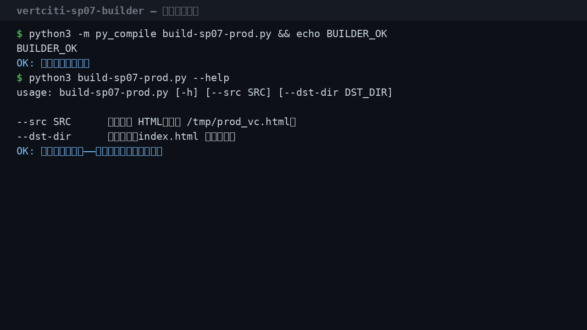

[](https://github.com/HUIIIM/vertciti-sp07-builder/actions/workflows/ci.yml)
[](https://github.com/HUIIIM/vertciti-sp07-builder/actions/workflows/gitleaks.yml)
[](LICENSE)

> **历史档案（已封存）**：这是商城时代的 SP-07 生产页构建工具＋机器可读
> 商品数据（2026-09-25）。商城已于 2026-09-30 全线下架（D314），**本仓库
> 不代表任何在售产品或服务**，仅作工程档案保留。

**一个"不许出半成品"的页面构建器**——从 D111-safe 基准 HTML 出发，做
v1.1 logo 语法归一化＋ 6 处 SP-07 内容编辑；每个锚点必须恰好出现 1 次，
缺一个就大声失败，绝不静默产出半成品。



> demo GIF 为本机真实运行：语法检查 → `--help` → 读取 machine/ 数据。
> 完整构建需要基准 HTML（历史产物，未收录），故此处不伪造构建输出。

## 30 秒 quickstart

```bash
cd vertciti-sp07-builder
python3 -m py_compile build-sp07-prod.py && echo BUILDER_OK
python3 build-sp07-prod.py --help
```

完整构建（需自备基准 HTML）：

```bash
python3 build-sp07-prod.py --src /path/to/base.html --dst-dir /path/to/out
```

## 它是怎么工作的



- **输入**：D111-safe 基准 HTML（`--src`）＋ `machine/` 机器可读数据。
- **构建**：`build-sp07-prod.py` 做两件事——① v1.1 logo 语法归一化（零视觉
  变化）；② 6 处 SP-07 内容编辑（含 Stripe 付款链接注入）。
- **断言**：`rep()` 要求每个锚点**恰好出现 1 次**，否则 `ASSERT FAIL` 直接
  退出——这是本工具的核心设计：构建失败必须吵，不能哑。
- **输出**：`--dst-dir/index.html`，SP-07 生产页。



## machine/：机器可读商品数据（2026-09-25 历史快照）

| 文件 | 内容 |
|---|---|
| `catalog.json` | 6 个标准包（SP-01~SP-06）：范围、交付物、排除项、内测价、下单方式 |
| `categories.json` | 15 个 AI 能力分类（角色/手艺/数据与基建）：定义、交付物、计价模型 |
| `manifest.json` | 总清单：阶段 `human_selected`（人选）、机器下单 `planned`（未开放） |
| `ratings.json` | 供应商评分标准 v1：维度、权重、等级映射（当时评分数据为空） |

诚实注脚（数据自带）："全部为内测价，供应商数量为 0，评分为空；屏障事项
明确标注 planned，不伪装成已上线能力。"——这是商城时代的原始诚实口径，
原样保留。

## 诚实约定

- 本仓库是**历史档案**：构建器与数据均为 2026-09 商城时代产物；商城下线
  后不再用于任何生产构建。
- 不虚构构建产物：没有基准 HTML 就不跑完整构建，不贴假输出。
- 数据中的价格/阶段/评分状态均为历史快照，不代表现状。

## 测试

```bash
python3 -m py_compile build-sp07-prod.py && echo "py OK"   # 2026-10-02 本机实测通过
```

CI（`.github/workflows/ci.yml`）：Python `py_compile`＋ shellcheck，push/PR
自动跑；gitleaks 密钥扫描随每次 push/PR/定时运行。

## 贡献

本仓库为 vertciti 内部工程档案，暂不接受外部 PR；发现问题请走内部渠道。

## 关于 vertciti

vertciti 为 Miao 构建运营人生的个人 AI 基础设施。

## 许可证

vertciti clean-room engineering — proprietary. 详见 [LICENSE](LICENSE)。
